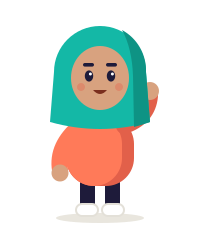
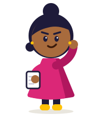

# Vespid Design System & Skills

Source of truth for Vespid's illustration and badge system: the two Claude skills that generate badges and Kawan cast characters, the cast reference drawings, and every exported asset that ships to the app.

> **Keep this repo private.** It holds client IP (Vespid brand, cast, badge system).

## What's in here

```
skills/
  vespid-badge-generator/       Milestone, Streak and Campaign badges (SKILL.md + outline script + glyphs + font licences)
  vespid-character-generator/   Kawan cast poses, turnarounds, expressions, new candidates
assets/cast/
  cast-*.svg                    Standalone reference drawing per cast member (generated, do not hand-edit)
  kawan-cast-summary.jpg        Cast overview sheet
exports/
  badges/{milestone,streak,campaign}/   Final outlined SVGs, ready for Figma and the app
  characters/                   Final character SVGs for scenes (onboarding, empty states)
tools/
  check_cast_sync.py            Fails if the two skills' cast drawings differ; --export rebuilds assets/cast/
  lint_svg.py                   Export-safety lint (no live text, no paint-order, no <style>, aria-label present)
```

## The cast

| | Name | Shape | Role | Status |
|---|---|---|---|---|
|  | Aina | Circle | The Planner | Confirmed |
|  | Wei Jie | Pill | The Spontaneous One | Confirmed |
|  | Priya | Triangle | The Go-getter | Confirmed |
|  | Ryan | Square | The Steady One | Confirmed |
| — | Uncle Halim | Half-circle | The Saver | **Candidate.** Not in skills, not for badges. Open: persona name vs "Saver" badge, grey brows, community review |

## Rules that keep the system consistent

1. **One source for the cast.** Both skills embed the same `<g id="cast-…">` drawings. Change them in both files in the same commit, then run `python3 tools/check_cast_sync.py --export`. CI blocks drift.
2. **Only outlined SVGs go in `exports/`.** Run `skills/vespid-badge-generator/scripts/outline_text.py` on every badge before committing. CI runs `tools/lint_svg.py`.
3. **File naming:** lowercase kebab-case with tier or days, e.g. `budgeter-iii.svg`, `streak-030-on-fire.svg`, `campaign-price-buster.svg`. Keep live-text sources only if asked, suffixed `.live.svg`.
4. **Locked decisions change by PR only**, with a line in [CHANGELOG.md](CHANGELOG.md) saying what changed and who signed off.

## Using the skills

- **Claude (claude.ai / desktop):** zip a skill folder (e.g. `skills/vespid-badge-generator/`) and upload it under Settings → Capabilities → Skills, or keep it in the Vespid project.
- **Claude Code:** copy or symlink the folder into `~/.claude/skills/` (personal) or `.claude/skills/` (per-project).
- **Other tools:** paste the `SKILL.md` as the system prompt. Without code execution, badges come back with live text; outline them in Figma (select text → Flatten) before export.

## Quick checks

```bash
python3 tools/check_cast_sync.py      # cast drawings identical in both skills
python3 tools/lint_svg.py             # all exports are export-safe
```

## Licences

- Vespid brand, cast and badge designs: proprietary, all rights reserved.
- Glyph outlines in `vespid_glyphs.json`: derived from Anton, Baloo 2, Nunito Sans (SIL Open Font Licence 1.1, see `skills/vespid-badge-generator/licenses/`).
- Icon paths: Phosphor Icons v2.1.1 (MIT).
